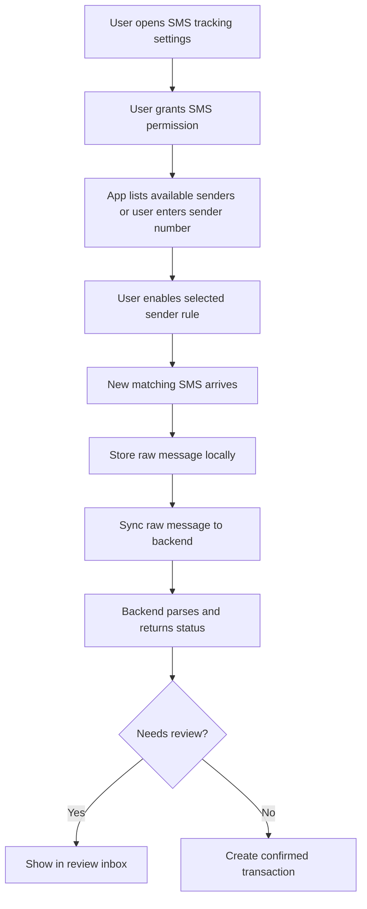

# finance-mobile

## Recovering older transaction SMS originals

After the API migration, transaction-related SMS uses **Keep** retention by
default, including existing capture preferences. OTP/security and promotional
messages remain excluded. For an already redacted transaction SMS, choose a
history date range that includes it and enable **Refresh previous imports**.
Retention-policy redactions can be restored during that refresh; for a manual
redaction or an older redaction with unknown cause, also enable **Restore text I
previously removed**. The API restores original text only when the sender,
timestamp, and body hash match its saved record and retention is Keep. Confirmed
ledger entries are not duplicated. The phone
must still contain the SMS; otherwise the original text cannot be recovered.

Legacy manual-entry queue and account, category, and transaction caches now
use local keys scoped to the API URL and authenticated user ID. The app clears
in-memory account data on logout or account switch. Earlier shared AsyncStorage
keys had no trustworthy owner and are removed rather than replayed for another
user; any unsynced entries in that older queue must be entered again. SMS review
loads 100 candidates at a time and shows the total pending count with a load
more control.

React Native Android app for quick capture and SMS-based transaction tracking.

## Current Status

Phase 1 scaffold now includes:

- Expo + React Native TypeScript setup.
- Bundled Material Community icon font preloaded before rendering app screens.
  Standalone builds include the SDK-compatible `expo-file-system` native module
  required by `expo-asset` to copy the font into its local cache. Font loading
  failures show a readable startup error instead of silently blank icons.
  The Android manifest blocks the dependency's external-storage permissions;
  font loading only uses the app's private cache.
- Environment-based API base URL (`EXPO_PUBLIC_API_BASE_URL`).
- Health check screen that calls `GET /api/health/`.
- Login test flow that calls `POST /api/auth/login/`.
- Access-token validation flow that calls `GET /api/auth/me/`.
- Persistent mobile session backed by Expo SecureStore:
  - stores the rotated JWT pair in Android Keystore-backed storage
  - validates the saved access token on launch and refreshes only when needed
  - transparently refreshes and retries authenticated API calls once after a
    mid-session `401`
  - revokes the refresh token and removes the saved session on explicit logout
- Account and category fetch flow for authenticated users:
  - `GET /api/accounts/`
  - `GET /api/categories/`
  - caches the latest account/category lists locally for offline form choices
- Configurable Quick Add presets and secure pending entries (see below).
- Legacy detailed transaction form: `POST /api/transactions/`.
- Legacy local manual transaction queue:
  - stores manual transaction drafts with AsyncStorage
  - syncs queued manual transactions to `POST /api/transactions/`
  - uses retry metadata and capped retry backoff for failed syncs
  - blocks obvious duplicate queued transactions
  - lets the user remove invalid queued transactions manually
- Transaction list flow:
  - `GET /api/transactions/`
  - caches the latest loaded transactions locally for offline startup review
- SMS tracking settings scaffold:
  - Android SMS permission gate for custom native builds
  - `GET /api/payment-methods/`
  - `GET /api/messages/sender-rules/`
  - local sender rule enable/disable selection
  - applies exact, contains, and regex rules consistently across React Native,
    native capture, and the backend
  - immediately syncs sender-rule toggle changes into the local native module
  - discovers distinct sender names and message counts from the Android inbox
    without exposing message bodies in the rule picker
  - supports sender search, account mapping, provider selection, backend rule
    creation, local enablement, and immediate native-rule sync
  - loads and updates the server-side capture policy for provider,
    OTP/security, and balance-notice exclusions
  - wraps capture-policy and retention options into visible rows, with 48-point
    minimum tap targets and multi-line labels for larger text sizes
  - cancels a setting selection after touch movement exceeds eight points,
    including a drag that returns to its start; accessibility activation remains
    available without a touch gesture
  - removes excluded providers from native sender capture immediately
  - presents a four-step setup checklist and lets the user choose immediate,
    7-day, 30-day, or manual raw-SMS redaction after confirmation
  - publishes permission, queue, failure, scan, and successful-sync heartbeats
    to `POST /api/messages/device-status/`
- Local raw message queue:
  - stores queued raw messages with Android Keystore-backed encryption in
    native builds or Expo SecureStore as a fallback
  - shows inline loading, success, empty, and error feedback when sender rules
    are refreshed, including the signed-in username for account troubleshooting
- Historical SMS backfill in native Android builds:
  - lets the user scan only new messages or choose a historical date range
  - evaluates only user-enabled sender rules
  - records deterministic message fingerprints so previously scanned messages
    are not imported again
  - can deliberately revisit previous imports and re-run pending review items
    through the latest backend parser without rewriting confirmed transactions
  - queues before uploading so an interrupted sync does not lose a message
  - syncs queued messages to `POST /api/messages/import/`
  - keeps failed sync items queued for retry
  - records attempt count, last attempt time, next retry time, and last error per queued message
  - uses a capped exponential retry delay so failed messages are not retried on every tap
  - blocks obvious local duplicate queue entries before backend sync
  - lets the user remove invalid queued messages manually
  - uploads newly received, trusted SMS messages with WorkManager when a
    network is available, including one JWT refresh attempt
  - keeps API-rejected messages encrypted on the device for explicit retry
  - exposes a two-step, debug-build-only reset that clears local scan memory and
    the signed-in user's backend SMS test data; the backend rejects it when
    `DJANGO_DEBUG=false`
- SMS review inbox:
  - loads parsed candidates from `GET /api/messages/review/`
  - focuses on one candidate at a time with previous/next navigation
  - shows parser hints, raw SMS evidence, and internal-transfer flags
  - shows parser confidence, raw message status, and review/duplicate reasons
  - lets the user correct amount, date, type, accounts, payment method,
    category, counterparty, reference, and note before confirmation
  - confirms or rejects candidates through the review endpoints
  - remembers corrected account, payment method, category, and transaction type
    for later messages from the same sender rule
  - records a rejection reason and can redact the body, disable the matched
    sender, or exclude the provider from one scoped decision dialog
- Debt/lending section:
  - loads records from `GET /api/debts/`
  - creates lent/borrowed records through `POST /api/debts/`
  - records repayments through `POST /api/debts/{id}/payments/`
  - shows open balances, due dates, compact totals, due-soon counts, and status
    chips
- Credit card bills section:
  - loads bills from `GET /api/credit-card-bills/`
  - creates statement bills through `POST /api/credit-card-bills/`
  - records payments through `POST /api/credit-card-bills/{id}/payments/`
  - shows remaining balances, due dates, compact totals, due-soon counts, and
    status chips
- Recurring bills section:
  - loads schedules from `GET /api/recurring-bills/`
  - creates repeating bills through `POST /api/recurring-bills/`
  - records payments through `POST /api/recurring-bills/{id}/payments/`
  - advances the next due date after payment and summarizes active bills,
    monthly recurring total, and due-soon count
- Balance reconciliation section:
  - loads expected balances from `GET /api/reconciliation/accounts/{account_id}/`
  - saves real-life balance checks through `POST /api/reconciliation/snapshots/`
  - shows expected, actual, difference, latest snapshot status, and difference
    context in compact mobile metrics
- Transaction API types include strict ledger evidence fields such as
  debit/credit direction, balance after, reference, counterparty text, payment
  method, raw message link, and duplicate key
- Manual quick entry and its offline queue preserve an optional provider-reported
  balance after the transaction.
- Native SMS permission/module decision documented in
  `docs/mobile-sms-permission-decision.md`.
- Native Android SMS capture setup documented in
  `docs/native-sms-capture.md`.

## Local Run (Current)

Prerequisites:

- Node.js installed
- Android Studio emulator running (or physical Android device)
- Backend API running on `http://localhost:8000`

Setup:

```bash
cp .env.example .env
npm install
npm run start
```

From Expo terminal:

- Press `a` to open Android emulator.

If using Android emulator, default API base URL in `.env.example` already uses:

```txt
http://10.0.2.2:8000
```

If using a physical device, replace it with your machine's LAN IP:

```txt
EXPO_PUBLIC_API_BASE_URL=http://192.168.x.x:8000
```

The mobile login flow uses OS-backed SecureStore and rotates the saved JWT pair
on app launch. See `../../docs/auth-token-storage-plan.md`.

## Native Android SMS Capture

Run mobile checks from this project directory:

```bash
npm run typecheck
npm run test:gestures
```

The gesture tests cover tap-versus-drag handling for capture settings. Verify
wrapping, larger text sizes and swipe cancellation on a physical Android phone.

The app includes a local Android native module under
`modules/finance-sms-capture/`. It is only available in a generated Android
build, not Expo Go.

Fresh device setup:

```bash
npm install
cp .env.example .env
npx expo prebuild --platform android
npx expo run:android --device
```

On a physical phone, set `EXPO_PUBLIC_API_BASE_URL` to the backend machine's LAN
IP before running. Then sign in, load sender rules, enable trusted senders, and
request Android SMS permission. New matching messages are encrypted locally and
scheduled for background upload; history scans remain an explicit user action.

See `docs/native-sms-capture.md` for the full workflow and troubleshooting
steps.

## Signed Android Release

The release build reads its keystore path, alias, and passwords from private
Gradle properties or environment variables and refuses to fall back to the
debug key. Follow `docs/signed-android-release.md` to create the permanent key,
build the signed APK, verify its signature, install it on a phone, or produce an
Android App Bundle.

## Docker (Optional)

From `projects/finance-infra`:

```bash
cp .env.example .env
docker compose --profile mobile up --build finance-mobile
```

For day-to-day development, native Expo on host is still the recommended path.

## Responsibilities

- Automatic Android SMS capture from user-enabled sender rules.
- Reliable local message queueing and backend sync.
- Review and confirmation of parsed transaction candidates.
- Account/category and transaction sync.
- Quick manual transaction entry as a fallback.
- Android SMS permission flow.
- User-selected tracked SMS sender numbers.
- Local raw message storage.
- Message sync to backend.
- Review parsed transactions.
- Offline queue for manual entries.

## Suggested Stack

- React Native
- TypeScript
- React Navigation
- TanStack Query
- SQLite or MMKV for local queue/cache
- Native Android SMS module when needed

Expo can be used only if the SMS requirements remain compatible. If automatic
SMS reading requires native Android APIs not supported by Expo Go, use Expo
prebuild/custom dev client or bare React Native.

## Android SMS Tracking Flow

Current decision: keep Expo Go as the manual-import/testing path and use the
local native Android module only in custom dev client or personal APK builds.
Native capture is sender-rule scoped. New messages can sync through Android
WorkManager, while foreground and historical scans use the same encrypted
raw-message queue and backend trust check.



## Mobile Screens

```txt
Home
Quick Add Transaction
Transactions
Accounts
SMS Tracking Settings
SMS Review Inbox
Debts
Settings
```

## Offline Requirements

- Manual transactions can be saved offline in a local queue and synced later.
- Account/category choices are hydrated from the last successful local cache.
- The latest loaded transaction list is hydrated from the last successful local
  cache for offline startup review.
- Raw SMS messages can be queued offline.
- Sync retries when network is available and keeps per-message failure context.
- Failed raw SMS sync items wait for their next retry time before another attempt.
- Obvious local duplicate raw messages are blocked before sync.
- Conflicts are resolved by backend timestamps and ids.

## Phase 1 Mobile Milestones

1. Android app skeleton. Done.
2. Login. Done with placeholder/testing flow.
3. Backend health check. Done.
4. Account/category fetch. Done.
   - Local account/category cache. Done.
5. Quick add transaction. Done.
6. Local manual transaction queue. Done with retry metadata, capped retry
   backoff, local duplicate checks, and manual removal.
7. Transaction list. Done with local recent transaction cache hydration.
8. SMS sender selection scaffold. Done.
9. Local raw message cache and sync queue. Done.

## Phase 2 Mobile Milestones

1. SMS permission gate scaffold. Done.
2. Sender number management scaffold. Done.
3. Native Android SMS module decision. Done.
4. Local raw message cache. Done.
5. Raw message sync. Done with retry metadata, capped retry backoff, local
   duplicate checks, and manual removal for invalid queued messages.
6. Review inbox. Done.
7. Source/destination transfer controls. Done.
8. Native Android SMS capture scaffold. Done for custom dev client/personal APK
   builds.

## Phase 4 Mobile Milestones

1. Debt/lending screen. Done for first mobile scaffold.
2. Credit-card bill screen. Done for first mobile scaffold.
3. Recurring-bill screen. Done for first mobile scaffold.
4. Reconciliation screen. Done for first mobile scaffold.
5. Compact mobile summary metrics and status chips for debt, card, recurring,
   and reconciliation workflows. Done for first polish pass.

## Suggested Transfer Matches

SMS confirmation and manual transfer entry show a native suggestion dialog for
existing transfers or opposite pending messages, including the same provider.
Explicit linking retains one movement and each account's SMS reference/balance.
Manual transfers and SMS review accept debit (this account sends) or credit
(this account receives), plus the other account. Incoming review drafts preselect
the receiving account and Credit; submitted SMS corrections set
`account_perspective: true` and preserve the selected account’s reported balance.
Offline sync pauses for a transfer match decision and retains this and subsequent queue entries. Resolve the suggestion
and sync again to continue. Queue restoration preserves direction, the other
account, and the transfer retry key. The all-account activity feed displays a
single A → B movement and its account-specific evidence.

Promotional capture policy is enabled by default and can be toggled alongside
OTP/security and balance notices. The API classifies English/Bangla offers and
acknowledges excluded captures without storing the original body; the Android
trusted-sender scan may still upload a message for server classification. Keep
the bank sender active so its financial notices continue to sync.

## Activity After Ledger Corrections

Web/API corrections can reclassify a matched transfer while retaining its
observations and source messages as history. Activity transaction details display account-specific
transfer balances/references only when the entry's current `type` is `transfer`;
historical observations on an expense or other type do not appear as active
transfer balances. Its normal account and ledger amount continue to come from
the corrected transaction. The full ledger editor is currently a web workflow.

Transfer evidence cache normalization preserves the read-only `is_primary` flag.
Older cached records default to false without inferring an observation from another
account. This keeps the generated transfer response type compatible with old caches.

## Installed Android queue and layout (0.1.4)

Installed builds use a single native SMS upload queue for captures and scans.
Existing app retry records migrate without losing their import identities.
Uploads persist progress after each successful response, retry temporary failures,
and retain rejected records for explicit retry. Header and scan counts share the
native pending count; the activity summary identifies pending manual entries.
Foreground status refresh reads local native metadata, not a periodic backend API.
The header and tabs respect Android system insets, and card text wraps within its
available width. See `docs/native-sms-capture.md` for details and checks.

## Configurable Quick Add and secure pending entries

The header plus button, Home favorite shortcuts, Activity manual-entry action
and More > Quick Add presets use the same preset API as web. Users can create,
edit, duplicate, enable/disable and reorder their own expense/income presets.
At most six favorite enabled shortcuts appear initially; See all reveals others.
Account/category choices are shortlists derived from favorites with searchable
See all. A shortcut prefills a draft; only Save records it. Overrides do not edit
the preset, and applying another preset retains typed amount/note/merchant.
Full entry carries the draft into the existing detailed tools for advanced types.

Quick Add waits for the native popup's `onShow` event before focusing Amount or
Preset name, and focuses once when switching from the preset manager to an editor.
Typing, reference refreshes and same-user token refreshes keep the input mounted
without requesting focus again. Android lets the native dialog resize for the
keyboard; iOS retains padding-based keyboard avoidance. The form keeps offscreen
inputs attached and does not dismiss the keyboard when scrolling.

Today/Now resolve when saving. Yesterday, native calendar, unknown time and a
native hour/minute picker support backdated entries. Android uses the system
clock, including exact-minute text input; iOS uses a spinner with Apply/Cancel.
Both have an exact input fallback. The picker is the Expo SDK 53-compatible
`@react-native-community/datetimepicker` 8.4.1, listed in dependencies and Expo
plugins. An existing signed app needs a new native build to include it; changing
JavaScript alone cannot add the native module. No APK is built as part of this
source change.

Quick Add saves the immutable request to a separate encrypted SecureStore queue
before clearing the draft or showing success. Its reference cache and queue are
scoped by backend and JWT user ID; decoding is for local isolation only, while
the API verifies authentication and ownership. Chunk manifests publish last,
protecting the previous queue if storage fails. Invalid/incomplete queue data is
retained and blocks new writes instead of being silently discarded.

The queue holds up to 100 entries. Foreground retry checks run every 30 seconds
only when entries exist, and send only due items. Backoff rises from 15 seconds
to 15 minutes. App resume refreshes choices and attempts due entries; successful
sync refreshes Activity/references. This feature does not poll empty queues or
post while the app is suspended. Background SMS WorkManager remains separate.
A snackbar distinguishes Saved on device from Synced to ledger. Activity's
manual pending count includes both this queue and the legacy detailed-form
AsyncStorage queue; the header SMS count continues to mean native SMS only.

Each Save has a new UUID, so equal purchases are allowed. Retries preserve the
same UUID and payload to avoid duplicate ledger rows after a lost response.
Validation errors remain visible and can be corrected; conflicts require ledger
review. Removing a pending device copy never deletes a ledger record, and a
request with an uncertain outcome may already have posted. The legacy detailed
manual queue is retained, not silently migrated into the new queue.

Run `npm run typecheck`, `npm run test:quick-add`, `npm run test:quick-add-focus`, `npm run test:network` and
`npm run test:gestures`. Secure document tests use an injectable store; native
picker, keyboard, modal and device storage behavior still need a physical-device
check. The 0.1.5 signed build verifies bundling, signature and native module packaging.

### Release 0.1.5

The Quick Add native release is version 0.1.5, Android version code 6. Keep the
version fields in Expo config, Gradle, package metadata and SMS status aligned.
`metro.config.js` includes the sibling `finance-contracts` folder so the shared
runtime helpers are bundled into the installed app; TypeScript checks alone do
not validate Metro's file visibility. Follow the signed-release guide to build
and verify the APK with the existing signing key.

### SMS recovery release 0.1.6

Version 0.1.6 (Android code 7) fixes Retry requests waiting behind old backoff
chains. Capture triggers coalesce, active uploads continue, and app resume or a
validated network transition resumes eligible SMS. Background retries use a
30-second linear base. Network/server errors display amber Waiting; rejected or
unauthorized records require Attention. Counts stay tied to actual encrypted
pending messages and change only after acknowledgements. See the native SMS
capture guide for diagnostics and `npm run test:sms-sync` for presentation checks.

### Upload investigation release 0.1.7

Version 0.1.7 (Android code 8) uses a shared native token-refresh owner for
foreground APIs and SMS work, a bounded OkHttp upload client, and a tested
upload engine that prevents a temporarily failing record blocking later records.
Long native operations use IO rather than Expo's shared status-read queue.
The capture screen offers Show/Share sync diagnostics using operational metadata
only, including stage, HTTP/error codes, counts and API host comparison. Encrypted
read failures preserve stored data and do not report a falsely empty queue.
See the native SMS guide for reproduced failures, test coverage and limits.

### Transfer comparison and review time

Possible matching transfers use a larger safe-area-aware modal, with the warning
and Entry being reviewed card fixed above a scrolling match list. The footer
keeps explicit actions visible; outside touches do not dismiss the modal. The
original reflects submitted edits and includes account path, amount, date/time
and optional merchant/note. References are hidden in comparison cards. Both sides
label missing times and distinguish pending SMS from recorded transfers. Receiving drafts
use sender-to-receiver order via the shared comparison helper. The selected SMS
review header shows its local received time alongside the date. This JavaScript
UI change requires a new installed app build; it is not included in the already
produced 0.1.7 APK.

The primary SMS review screen places a compact Debit/Credit button and change
icon beside the amount, replacing its two direction choices further down.
The reporting-account caption and accessibility hint explain the scope. A tap
updates only the existing candidate direction draft, retaining edited values,
selected accounts and classification; it does not confirm the message. The
44px button has a textual state and is disabled during confirmation. This source
UI change requires the next installed app build.

### Transfer matching balance conflicts

The matching modal displays account-labelled reported balances for both
entries. Same-account disagreements require a separate, explicit choice of
the matching entry or the entry being reviewed before linking. Unknown or
other-account balances are not conflicts. Choices include the reviewed values
so the API can reject stale decisions atomically. Original messages remain
available and the transfer still counts once. Deploy the updated API before
clients relying on `reported_balances` and `balance_choices`. Device rendering
of this matching flow still requires Android validation.

### Compact matching explanations

Transfer matching uses short labels and info/warning icons. Tap an icon to open a native explanation dialog. Same-account conflicts still show “Balances differ” and require an explicit balance choice; reading help never accepts a match. Each help target is at least 44 points with an accessibility label.

### Short account/card suffix suggestions

SMS review displays review-only sender/receiver suggestions for three-digit
suffixes, including saved account and card/method names. A longer saved identifier
can match a shorter SMS ending without another mapping. Weak initial account and
method defaults remain empty, even when there is a single match. Choose a
suggestion or the ordinary account selector, then explicitly confirm/link.

Suggestion buttons respect the draft Debit/Credit direction: the reporting choice
sets account and payment method, while the other choice sets the transfer account.
Other draft fields remain unchanged and no transaction is saved on a suggestion
click. Missing suggestion fields from older APIs default to an empty list.
One/two-digit identities are excluded; ownership/provider/kind scope and visible
digit conflicts are enforced by the API. Re-run parsing for old pending messages
whose shorter suffixes were discarded. This change requires a new mobile release
to display the buttons; no APK was built as part of this implementation.

### Native release 0.1.8 (superseded by 0.1.9)

Use 0.1.9 for installation: the 0.1.8 build failed during sign-in.
Version 0.1.8 (Android code 9) packages the native review changes above: transfer
comparison layout, review time/direction, account-bound balance conflict choices,
compact help and explicit short-suffix suggestions. The signed APK uses the
existing upload key for in-place upgrades. The web shared Add/Edit editor and
Undo controls are not native features in this release. Follow
[the signed-release guide](docs/signed-android-release.md) for installation and
physical-device checks.

### Sign-in bridge fix in release 0.1.9

Android code 10 fixes `initializeBackgroundSyncSessionAsync` rejecting with an
unknown `SmsSession` type after successful authentication. Native command methods
discard internal coordinator/scheduler results and resolve without returning
credentials or custom JVM objects. Storage/scheduling failures still reject.
Regression tests exercise session persistence and Expo result conversion; verify
sign-in and retained SMS on a physical phone after upgrading over 0.1.8.

Verification for 0.1.9: all 23 native tests (including three bridge regressions),
mobile typecheck and signed release assembly passed. The packaged APK was checked
for version 0.1.9/code 10, the same certificate as the previous APK, a bundled
JavaScript runtime and the exact MaterialCommunityIcons font. No connected
Android device or configured emulator was available for sign-in verification.

### Quick Add keyboard fix in release 0.1.10

Android code 11 waits for the native popup window before requesting input focus
and uses Android's own keyboard resize instead of shrinking the form twice.
Preset and transaction inputs stay mounted across typing and reference refreshes.
The signed update keeps the existing signing key and the 0.1.9 sign-in bridge fix.
After upgrading, test Create/Edit preset and Quick Add: type in several fields,
scroll with the keyboard open, and confirm Save/Cancel remain reachable. Native
keyboard behavior needs phone verification; component tests cover focus timing
and draft preservation.

Verification: mobile typecheck, all 23 JavaScript tests, all 23 native tests and
signed release assembly passed. The APK reports 0.1.10/code 11, matches the
previous signing certificate, and contains the JavaScript bundle and icon font.
No Android device or emulator was connected for the keyboard check.

### Session-scoped local data

The app validates and refreshes the current server-issued session automatically;
planning tools no longer expose login or token-entry controls. Local account, category, transaction and offline
queue caches continue to use the signed-in session's backend/user scope; offline
restoration reads the session saved in device secure storage. This removes the
in-app path for choosing another user's cache with a fabricated token. Existing
cached offline work remains available to its signed-in owner after reconnecting.

### Native release 0.1.11

Version 0.1.11 (Android code 12) packages the session-scoped cache restrictions,
100-record SMS review pages with Load more, and explicit restoration of previously
redacted SMS during historical reprocessing. Ordinary scans/reprocessing keep
restoration disabled. The restoration flag travels through the native encrypted
queue and upload engine, so an installed 0.1.10 app needs this new native build.
Use the current backend API for these workflows.

The signed APK uses the existing signing identity for an in-place upgrade and
retains the Quick Add keyboard and native sign-in fixes. Install
`dist/releases/finance-mobile-0.1.11.apk` over the existing app; keep the app
installed to preserve device-local queued work. Follow the
[signed-release guide](docs/signed-android-release.md) for verification and phone
smoke checks.

Release verification passed: mobile typecheck, 23 JavaScript tests, 23 native
tests and signed assembly. The APK reports 0.1.11/code 12, matches the previous
signing certificate, and contains the production API URL, JavaScript bundle,
icon font and updated native restoration code. Physical-device smoke checks
remain pending.
### Batch SMS sync in release 0.1.12

Version 0.1.12 (Android code 13) sends up to 25 SMS per request, bounded to 128 KiB,
with one batch in flight. The API must expose `/api/messages/import/batch/` for
the speedup; 404/405 switches the current worker run to the legacy endpoint.
The batch request has a 60-second total/read deadline; the worker retains its
four-minute processing budget and schedules continuation work when needed.

The uploader validates all correlation IDs/statuses before applying any receipt.
Confirmed items are removed, invalid items remain held for correction, and
temporary item failures are delayed for retry. Missing, duplicate or unexpected
receipts and lost responses retain the entire unacknowledged batch. Retries keep
the original device IDs, timestamps, SMS and explicit restoration choices. A
changed user/backend stops acknowledgements. A newer reprocessing/restoration
request or a newly captured message cannot be deleted by an older receipt.

One encrypted queue replacement is committed per completed batch. Running status
updates reuse one pending count and are throttled between completed batches;
message counts remain accurate but may advance in groups. Oversized messages
remain held instead of blocking later uploads, and HTTP 413 shrinks batches.
The native HTTP regression imports 552 messages in 23 requests; this demonstrates
reduced round trips, not a promised real-device speed multiplier.

Run `npm run typecheck`, `node --test tests/*.test.cjs` and the native unit tests
before assembly. Install `dist/releases/finance-mobile-0.1.12.apk` over the existing
app with the same key. Deploy the batch-capable API first; verify a long history
sync, disconnect/reconnect, app restart, account switching and Quick Add on a
physical phone. The legacy JavaScript fallback remains single-message sync;
the installed Android module owns automatic/background batch sync.

## Activity timeline and direct navigation

Activity uses the authenticated `/api/transactions/activity/` endpoint in pages
of 25. Search is debounced; account, category, type and transaction-date filters
use an Apply/Cancel sheet with searchable account/category/type choices. Date
modes are All, Daily, Monthly and Custom (inclusive, at most 366 days). Sorting
supports transaction date, recently added and recently updated; date filters
always refer to the transaction date. Added/updated grouping uses Asia/Dhaka.

The virtualized timeline has pull-to-refresh, retry and explicit Load more.
Duplicate page IDs are deduplicated; failed appends retain the loaded rows;
filter changes and unmount abort in-flight work and ignore late responses.
Opening/closing transaction details retains filters and the timeline position.
Details offer Edit transaction, which fetches the current saved entry by ID in a
full-screen native editor without resetting Activity filters.
Transfers show both account names, and an account-filtered view uses that
account's debit/credit perspective. Details preserve reported balances by account.

Home fetches/caches only the first 25 recent transactions and uses the API's
count for its Activity total. Cached previews are not presented as a complete
offline search result. Local caches and Activity filters reset on logout/user
switch. Deploy the new API before distributing an APK with these changes; an
older backend yields an actionable error rather than downloading an unbounded
legacy list. No database migration is required.

More groups Accounts, Planning and Settings. Debts, credit-card bills, recurring
bills and reconciliation open only their respective existing forms and load
that section's data. The drawer uses the same destination IDs. Accounts and SMS
settings open their maintained native screens. Visible Back and Android hardware
Back return to the prior screen. Quick Add's full-entry handoff opens the manual
entry form directly. Redundant legacy login, connection and SMS panels are no
longer mixed into every planning tool.

Tapping a Home review card selects its candidate ID before opening SMS review.
Selection follows that ID across queue reordering; removing the selected message
falls back to the nearest available item. Each candidate keeps its own draft.

Run `npm run typecheck` and `npm run test:activity` for the new timeline and
selection regressions, or `node --test tests/*.test.cjs` for all JS checks.
Physical-device checks still include keyboard behavior, large text, native Back,
long-history scrolling, offline/reconnect and switching signed-in accounts.

## Shared presentation and accessibility

The installed label, login, drawer and signed-in header now use **Finance**.
Package identity and Expo slug stay unchanged. See
[shared interface conventions](../../docs/interface-conventions.md) for formatting,
button hierarchy and scope. SMS review follows the web field sequence, exposes
calendar/clock controls, and keeps optional payment methods in a disclosure that
retains edits. Selected review choices expose checked state and a visible check;
Quick Add and Home/Capture selections use soft mint. SMS date/time and Today
defaults use one local calendar interpretation. Core transaction amounts retain
exact cents; missing candidate amounts are no longer displayed as zero.

Run `node --test tests/native-fields.test.cjs` for picker/draft regressions and
`node --test tests/*.test.cjs` for all mobile checks. A JS bundle export does not
replace testing picker appearance, TalkBack and the keyboard on the device. This
shared pass left native balance editing for the mobile pass below. Saved views
and an amount privacy toggle remain deferred.

Changing a known reporting account during SMS review now omits the original
account’s parsed balance and shows a visible warning; zero balances remain valid.
Type/direction corrections alone do not clear that account’s balance.

## Native review, editing and recovery (0.1.13)

SMS review now uses searchable account, category and payment-method sheets.
Selections are explicit; Cancel preserves the previous choice. An incompatible
category/type change asks for the intended type before updating classification.
Amount, date/time, reference, merchant and note remain editable. The reported
balance is labelled with its reporting account, accepts zero and negative
balances, and clears with a warning when that reporting account changes. Other
transfer accounts appear only for transfers. A pinned action bar keeps validation
and server errors next to Reject and Confirm & add.

**View full SMS** opens selectable original text and its sender/received time;
redacted or missing text shows its retention state instead. The native editor
loads SMS and statement evidence independently of the saved transaction, so a
slow evidence request does not reset or block an ordinary note correction.
Transfer balances are stored by account; reversal never swaps their ownership.
The second balance is optional and collapsed. Type/account/amount corrections to
linked entries require explicit acknowledgement after sources load successfully.
Edits patch only changed fields; a fresh timestamp check detects already changed
entries before saving. This check is not an atomic edit lock. A conflict keeps the
draft and offers explicit discard/reload. JWT refresh and lookup refresh do not
remount fields or replace unsaved text. Original provenance/identifiers remain
attached to the saved record.

Successful online Quick Add uploads, manual saves, SMS approvals, transfer links
and edits expose **Edit** and **Undo** in a short notification. More also keeps a
persistent latest-action card with Refresh. Offline queueing alone does not
claim a ledger save. Undo uses the existing API's latest unchanged action and
24-hour window; it cannot restore SMS already removed by retention. The client
rechecks eligibility, blocks repeated taps and reconciles a lost Undo response
with a read, never a blind repeated mutation. It is a latest-action control,
not a multi-action history. Recovery and edit requests are scoped to the signed-in
user/backend; stale responses cannot replace another user's screen.

Capture separates accepted-this-run, waiting, delayed and correction counts,
shows the last successful sync reported by the server and names automatic versus
manual retries. Server timestamps may include this user's other devices. Missing
or unreadable queue state never claims Ready. Delayed native counts exclude
held/rejected records. A reachable health endpoint confirms the server connection,
not completion of SMS upload or ledger approval.

Accounts show the ledger balance and the dated provider report separately.
Mismatch compares against the ledger **at the report**, with a direct balance
review action. Credit-card reports remain references, not cash-balance mismatches.
Cached account snapshots are labelled. Search choices, actions and new fields
have visible text, accessibility states and at least 48-point touch targets;
compact recovery actions wrap on narrow screens.

Run `npm run typecheck`, `npm test`, `npm run test:review` (focused interactions)
and the native unit tests before assembly. See the
[signed release guide](docs/signed-android-release.md) for 0.1.13/code 14 and the
phone acceptance checklist. These are native state/interaction tests, not proof
of physical keyboard, TalkBack or visual layout behavior. No new database
migration is added; the existing transaction Edit/Undo and account comparison
endpoints must be deployed. A recovery status failure never disables ordinary
review. Saved views and the privacy toggle remain deferred.

### Compact review and transaction forms

SMS review, full manual entry, saved-entry editing and Quick Add share native
compact form layouts. The grid measures its own available width and permits up
to three columns with a 260-point minimum field width. Larger system text raises
that minimum, so narrow screens and enlarged fonts stack rather than squeeze
controls. Classification and date/time groups may use two columns when they fit.
Date/time share one main-grid slot; native picker buttons sit beside exact text
inputs, with labelled 48-point targets. Seconds already present in a draft remain
unchanged until the user explicitly picks or edits a time.

Main account, type/category, amount, reporting-account balance, date/time and
merchant stay visible. Reference, note and payment method are grouped in mounted
More details disclosures where supported. Saved-entry source evidence and the
second transfer balance retain their existing disclosures. Transfer account
selectors appear only for transfers; balance-ownership notices and required
linked-correction acknowledgement stay visible. Validation opens More details,
and balance errors also open the secondary report in the saved-entry editor.

The full manual-entry screen now uses the existing searchable account/category
and type controls instead of asking users for raw IDs. It retains the existing
online save/offline queue handlers. Quick Add keeps its preset and offline flow;
its optional fields and date/time controls now stay mounted when hidden. Busy
saved-entry editing disables date/time controls instead of unmounting them.

Resizing, larger text, disclosures and reference/token refreshes change
presentation without replacing inputs or resetting draft state. SMS drafts stay
keyed by candidate in the current workspace; account-bound balance ownership,
category/type confirmation, save/undo, duplicate checks and queue retry rules
retain their existing behavior. This does not introduce draft persistence across
logout/restart, an automatic save or a new backend migration.

Run `npm run typecheck` and `npm test`. Added component regressions exercise
container widths, enlarged text, open search sheets, stable input identity,
optional-field disclosure, busy date/time retention, exact seconds, zero and dual
transfer balances, linked consent and the outgoing edited PATCH. Native host
mocks cannot verify Android IME, TalkBack, wrapping or physical window geometry;
use the signed-release checklist on a phone before accepting those behaviors.

Release **0.1.14 / Android code 15** includes the compact forms. Install the same-key
upgrade from `dist/releases/finance-mobile-0.1.14.apk`; see the
[signed release checklist](docs/signed-android-release.md#compact-form-release-0114).
